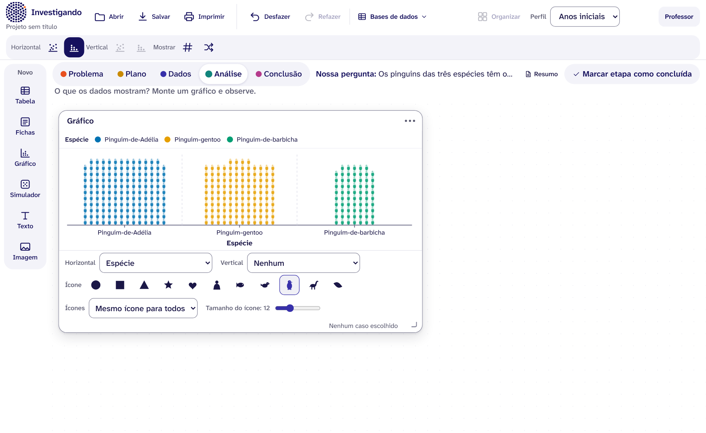

# Investigando

Programa para fazer pesquisas com dados na escola. Une as etapas do **ciclo investigativo** (Problema, Plano, Dados, Análise e Conclusão) à forma de trabalhar do TinkerPlots: o aluno monta tabelas, separa e empilha pontos em gráficos, simula situações de chance e escreve o que descobriu. Feito para o ensino fundamental, todo em português do Brasil.

## O que dá para fazer

- **Pesquisar em etapas:** a pergunta da turma fica sempre visível, e cada etapa tem um guia curto.
- **Montar tabelas** com os dados da turma ou escolher uma das **bases prontas**: pinguins, zoológico, cereais, incêndios florestais, sono dos mamíferos, tamanho de seres vivos, Brasil nos Jogos Olímpicos, Pokémon e filmes e séries do Disney+. Também é possível abrir qualquer arquivo CSV.
- **Explorar gráficos** arrastando os pontos: separar, empilhar, contar, tirar média e mediana. Os pontos podem virar ícones (peixe, pinguim, folha, estrela e outros).
- **Simular** sorteios e comparar com o que se esperava.
- **Escrever a conclusão** com apoio de frases iniciais e registrar dúvidas.
- **Salvar, abrir e imprimir** o trabalho em um arquivo `.investigando`.

Dois perfis ajustam a quantidade de ferramentas: **Básico** (essenciais, para os anos iniciais) e **Completo** (todas, para os anos finais). No **modo professor**, dá para travar etapas, esconder objetos, ligar ou desligar cada ferramenta do gráfico e proteger com PIN.

## Como instalar

Baixe o instalador do seu computador na página de [Releases](../../releases) (ou, enquanto não houver uma versão publicada, na aba **Actions → Instaladores**, dentro de "Artifacts").

| Computador | Arquivo | Como instalar |
|---|---|---|
| **Mac** (Apple e Intel) | `Investigando.dmg` | Abra o arquivo e arraste o Investigando para a pasta Aplicativos. Na primeira vez, clique com o botão direito no ícone e escolha **Abrir**. |
| **Windows** | `Investigando-setup.exe` (ou `.msi`) | Dê dois cliques. Se aparecer o aviso azul do Windows, clique em **Mais informações** e depois em **Executar assim mesmo**. |

O programa ainda não é assinado digitalmente, por isso aparecem esses avisos na primeira abertura. Detalhes e solução de problemas em [Instalar no Mac e no Windows](docs/INSTALAR.md).

## Documentação

- [Manual do usuário, com imagens](docs/MANUAL.md)
- [Bases de dados, fontes e licenças](docs/BASES-DE-DADOS.md)
- [Instalar no Mac e no Windows](docs/INSTALAR.md)
- [Para quem desenvolve](docs/DESENVOLVIMENTO.md)

## Situação

Todas as funções descritas acima estão prontas e testadas por testes automáticos. Ainda não foram conferidos na prática: a instalação nativa no Mac e no Windows, abrir arquivos `.investigando` com duplo clique, impressão em impressora e uso com leitor de tela.

## Regras do projeto

- O comportamento do TinkerPlots é reimplementado; nenhum código, imagem ou arquivo `.tp3` dele é copiado.
- Código adaptado do CODAP (licença MIT) mantém o cabeçalho de origem e o aviso do Concord Consortium.
- As bases de dados seguem as licenças de cada fonte, indicadas na tabela inserida no projeto e em [Bases de dados](docs/BASES-DE-DADOS.md).
