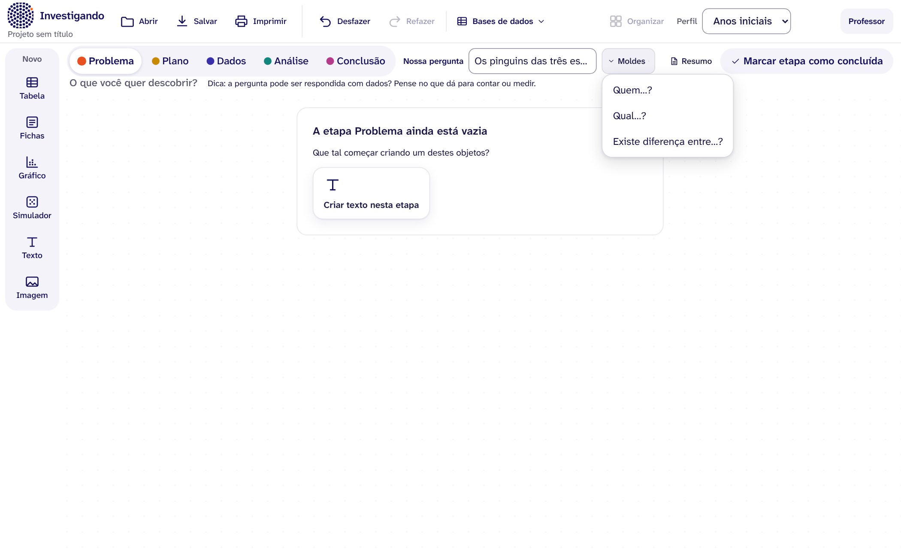
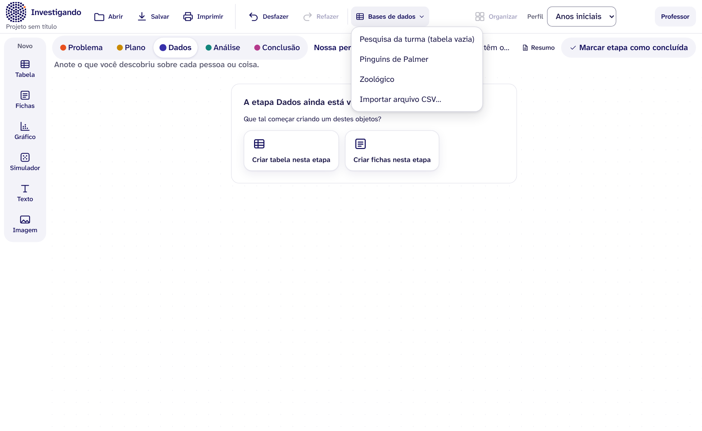
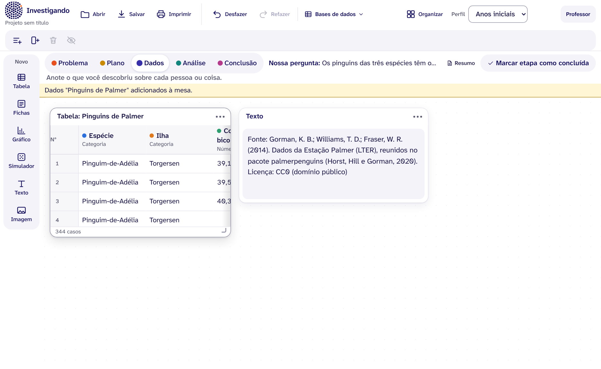
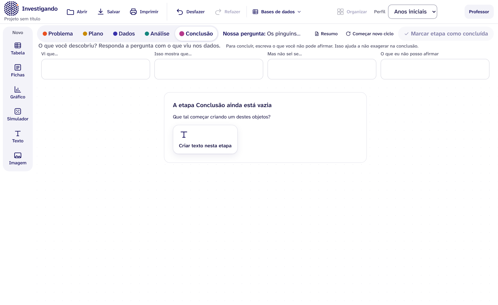
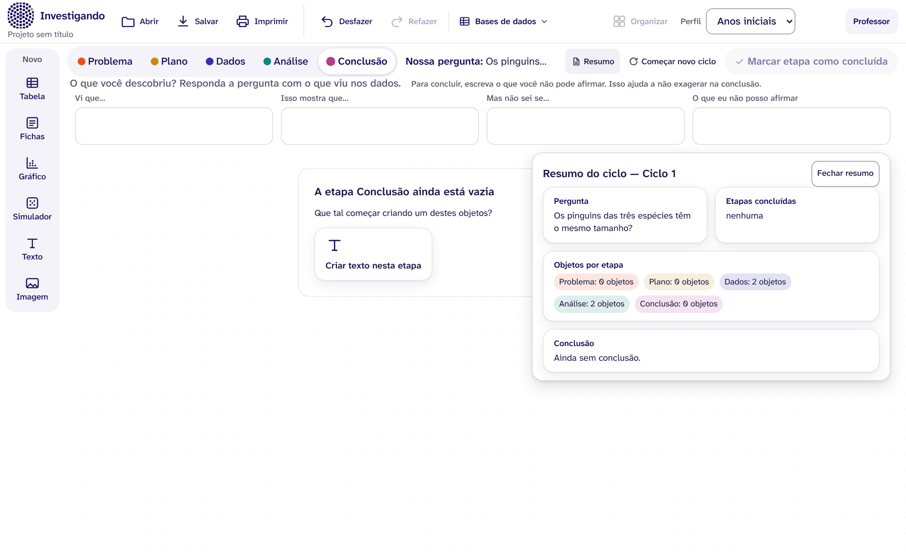
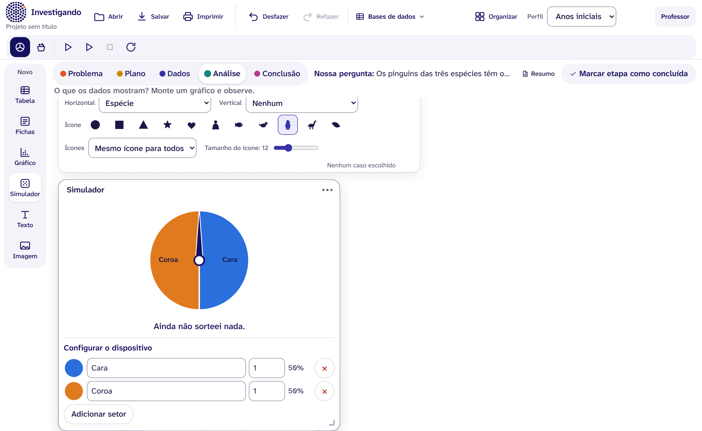
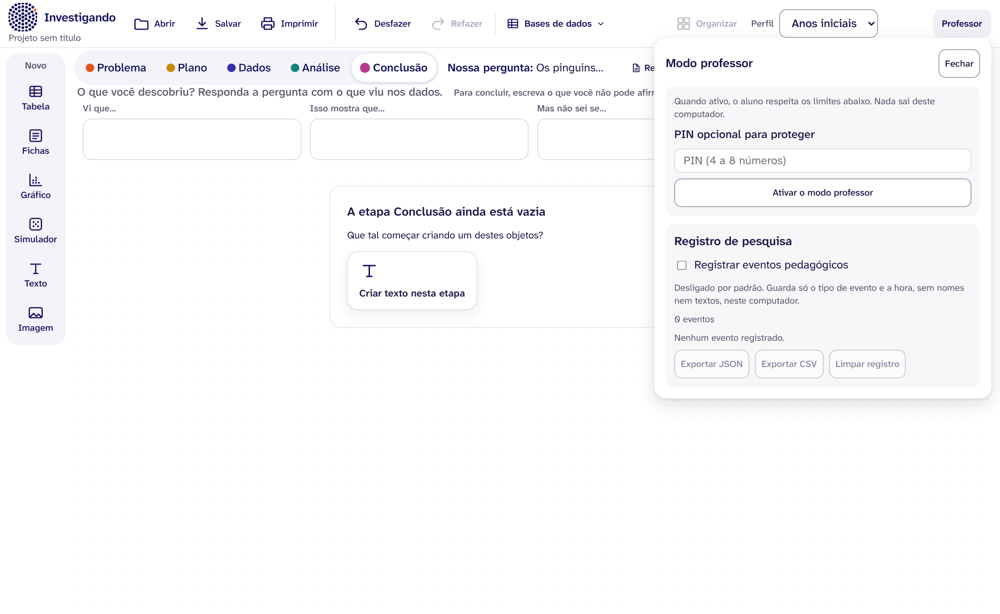

# Manual do Investigando

O **Investigando** é um programa para o ensino fundamental que une o **ciclo investigativo PPDAC** (Problema, Plano, Dados, Análise, Conclusão) a uma mesa de trabalho livre, no estilo das ferramentas de exploração de dados: tabela, fichas, gráfico de pontos soltos, simulador, texto e imagem, todos ligados entre si.

Tudo fica no seu computador. Os arquivos têm a extensão `.investigando`.

> As imagens deste manual usam, só como **exemplo**, a base *Pinguins de Palmer* e a pergunta "Os pinguins das três espécies têm o mesmo tamanho?". O programa abre vazio: a pergunta e os dados são da sua turma.

## 1. Visão geral da tela

Em cima ficam **Abrir**, **Salvar**, **Imprimir**, **Desfazer/Refazer**, **Bases de dados**, **Organizar**, o **Perfil** (Anos iniciais / Anos finais) e o **Professor**. À esquerda, a coluna **Novo** cria objetos. No centro, as cinco etapas do ciclo e a pergunta da turma. O título da janela mostra o nome do projeto.

## 2. As etapas do ciclo

### Problema
Escreva a pergunta da turma. O botão **Moldes** oferece modelos para ajudar a formulá-la.

### Plano
Combine o que será observado e como os dados serão registrados.

### Dados
Anote o que descobriu sobre cada pessoa ou coisa. A **Tabela** e as **Fichas** mostram os mesmos casos: mudar um muda o outro. Para começar depressa, use **Bases de dados**.

O menu traz **Pesquisa da turma** (tabela vazia, para a turma preencher), bases prontas e **Importar arquivo CSV…**. Veja o guia completo em [BASES-DE-DADOS.md](BASES-DE-DADOS.md). Cada base entra com um quadro de texto com a fonte e a licença.

### Análise
Monte um **Gráfico** escolhendo uma variável na horizontal e, se quiser, outra na vertical. Cada ponto é um caso. Use as ferramentas da barra superior para separar, empilhar e contar.

Os pontos podem virar **ícones**: círculo, quadrado, triângulo, estrela, coração, pessoa, peixe, ave, pinguim, dinossauro ou folha. Em **Ícones**, escolha uma categoria para que cada valor tenha o seu ícone (a legenda mostra qual é qual). O **tamanho do ícone** também pode ser ajustado.

### Conclusão
Responda à pergunta com base no que viu no gráfico.

**Marcar etapa como concluída** registra o avanço, e **Resumo** mostra o percurso da investigação.

## 3. Objetos da mesa

| Objeto | Para que serve |
|---|---|
| Tabela | Registrar casos e variáveis (texto, categoria, número). |
| Fichas | Ver cada caso como uma ficha. |
| Gráfico | Pontos soltos ou ícones para organizar e comparar. |
| Simulador | Sortear com roleta para testar ideias de acaso. |
| Texto | Anotar ideias, fontes e conclusões. |
| Imagem | Inserir uma foto ou desenho. |

### Simulador
Configure os setores (nome e peso) e sorteie.

## 4. Modo professor

Em **Professor** é possível limitar o que o aluno altera, com **PIN opcional**, e ligar o **registro de pesquisa**. O registro vem desligado, guarda só o tipo de evento e a hora (sem nomes nem textos), fica neste computador e pode ser exportado em JSON ou CSV.

## 5. Salvar, abrir e imprimir

- **Salvar** grava um arquivo `.investigando`; **Abrir** carrega um.
- **Imprimir** gera uma página limpa (use "Salvar como PDF" no diálogo).
- Desfazer/Refazer valem para todas as ações da mesa.

## 6. Acessibilidade

Fontes legíveis, alto contraste, navegação por teclado e rótulos para leitores de tela. Se encontrar algo que atrapalhe, abra uma *issue* no repositório.
