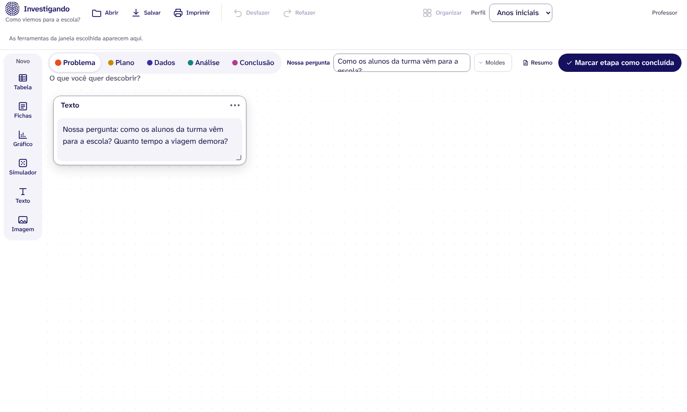
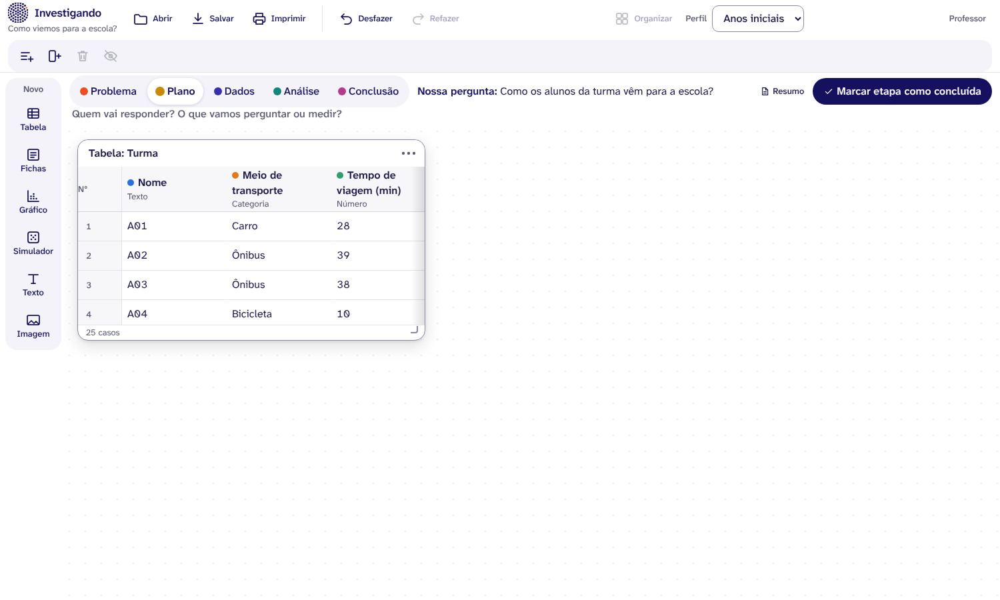
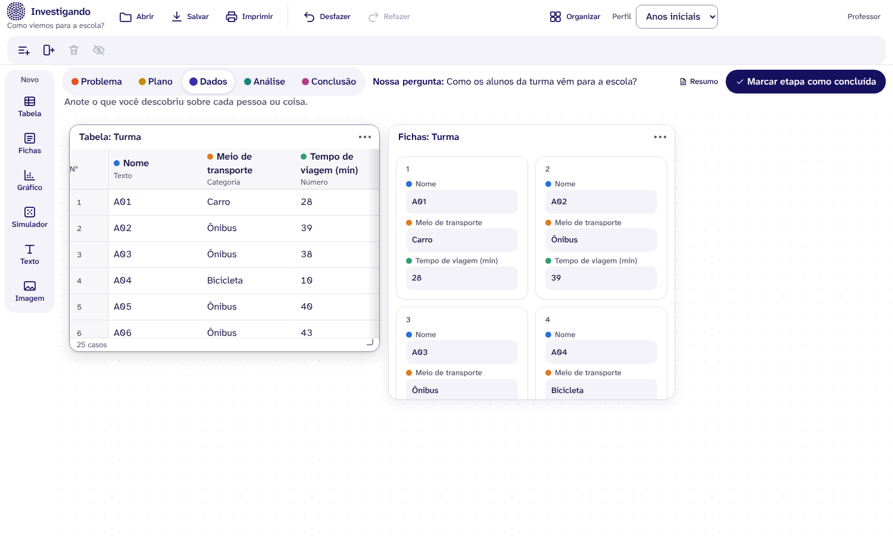
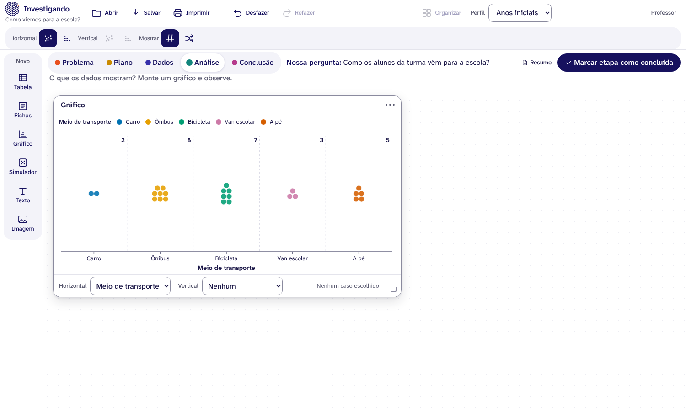
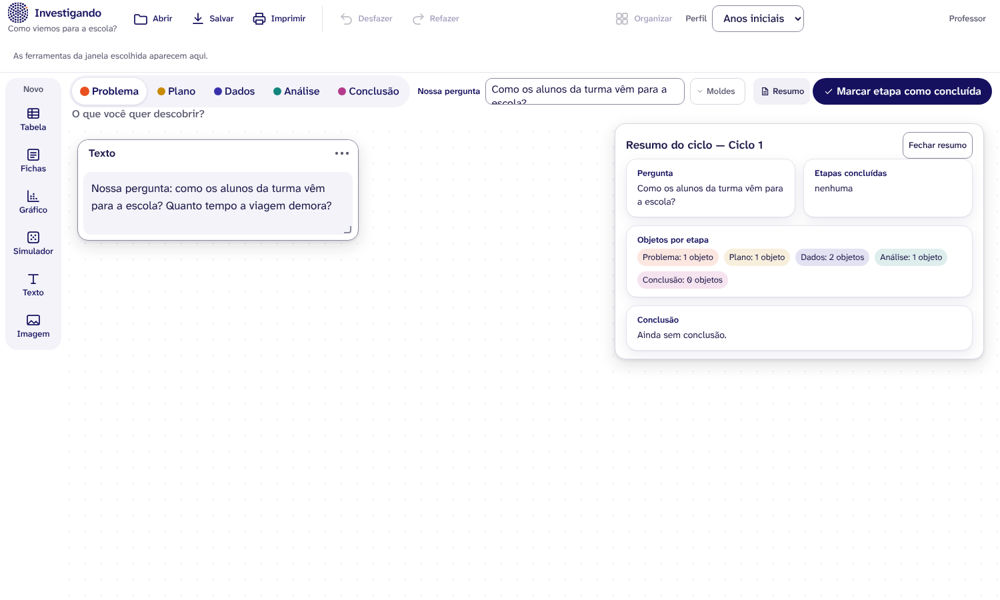
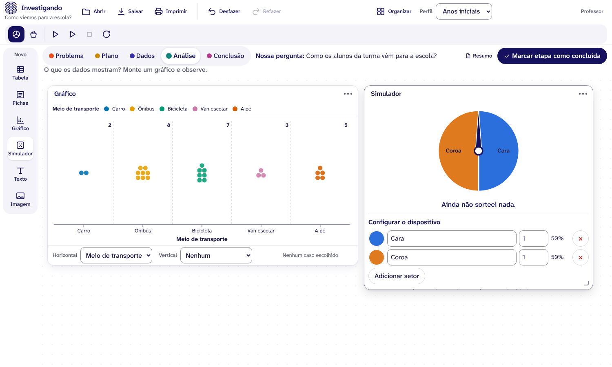
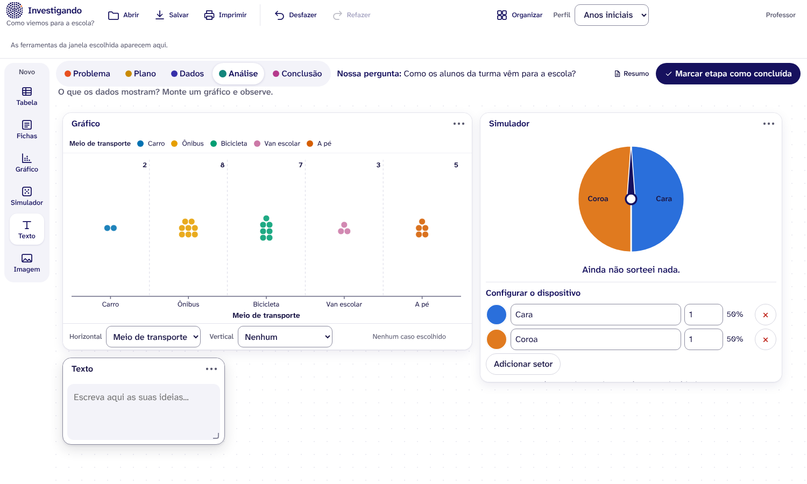
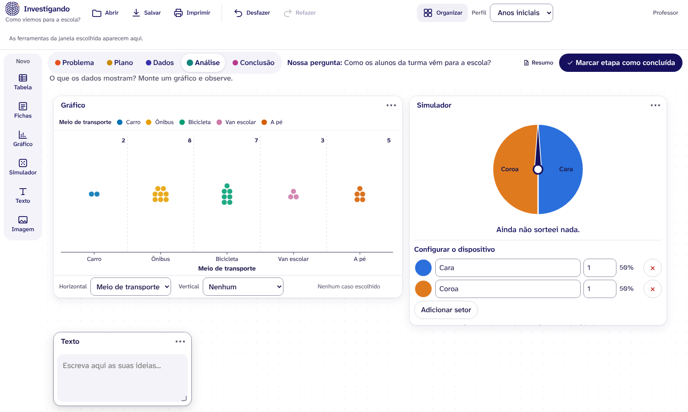
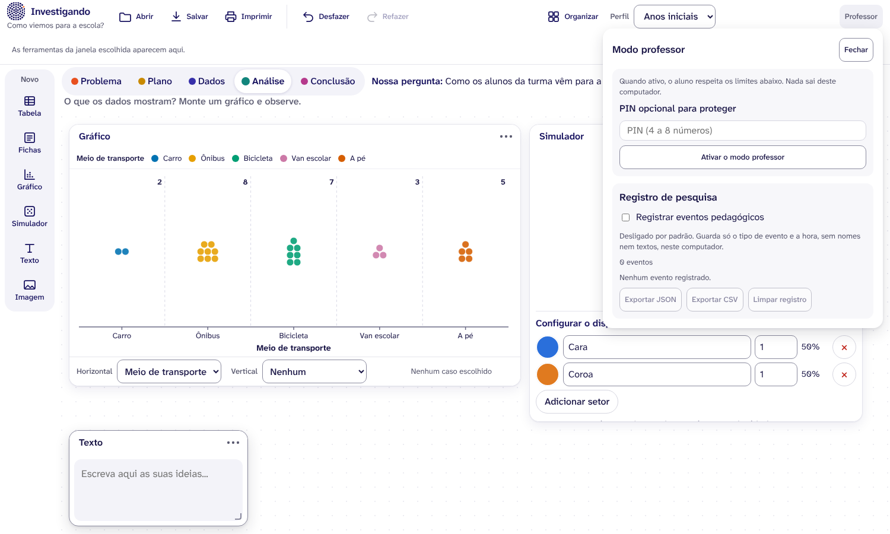

# Manual do Investigando

O **Investigando** é um programa para o ensino fundamental que une o **ciclo investigativo PPDAC** (Problema, Plano, Dados, Análise, Conclusão) a uma mesa de trabalho livre, inspirada na forma de explorar dados do TinkerPlots: tabela, fichas, gráfico de pontos soltos, simulador, texto e imagem, todos ligados entre si.

Tudo fica no seu computador. Os arquivos têm a extensão `.investigando`.

## 1. Visão geral da tela

Em cima ficam **Abrir**, **Salvar**, **Imprimir**, **Desfazer/Refazer**, **Organizar**, o **Perfil** (Anos iniciais / Anos finais) e o **Professor**. À esquerda, a coluna **Novo** cria objetos. No centro, as cinco etapas do ciclo e a pergunta da turma.

## 2. As etapas do ciclo

### Problema
Escreva a pergunta da turma. O botão **Moldes de pergunta** oferece modelos para ajudar a formulá-la.

### Plano
Combine o que será observado e como os dados serão registrados.

### Dados
Anote o que descobriu sobre cada pessoa ou coisa. A **Tabela** e as **Fichas** mostram os mesmos casos; mudar um muda o outro.

### Análise
Monte um **Gráfico** escolhendo uma variável na horizontal e, se quiser, outra na vertical. Os pontos são soltos: cada um é um caso. Use as ferramentas da barra superior para separar, empilhar e contar.

### Conclusão
Responda à pergunta com base no que viu no gráfico.

O botão **Marcar etapa como concluída** registra o avanço. **Resumo** mostra um painel com o percurso.

## 3. Objetos da mesa

| Objeto | Para que serve |
|---|---|
| Tabela | Registrar casos e variáveis (texto, categoria, número). |
| Fichas | Ver cada caso como uma ficha. |
| Gráfico | Pontos soltos para organizar e comparar. |
| Simulador | Sortear com roleta para testar ideias de acaso. |
| Texto | Anotar ideias e conclusões. |
| Imagem | Inserir uma foto ou desenho. |

### Simulador
Configure os setores (nome e peso) e sorteie.

### Texto

### Organizar
O botão **Organizar** arruma os objetos na mesa.

## 4. Modo professor

Em **Professor** é possível limitar o que o aluno altera, com **PIN opcional**, e ligar o **registro de pesquisa**. O registro vem desligado, guarda só o tipo de evento e a hora (sem nomes nem textos), fica neste computador e pode ser exportado em JSON ou CSV.

## 5. Salvar, abrir e imprimir

- **Salvar** grava um arquivo `.investigando`; **Abrir** carrega um.
- **Imprimir** gera uma página limpa (use "Salvar como PDF" no diálogo).
- Desfazer/Refazer valem para todas as ações da mesa.

## 6. Acessibilidade

Fontes legíveis, alto contraste, navegação por teclado e rótulos para leitores de tela. Se encontrar algo que atrapalhe, abra uma *issue* no repositório.
